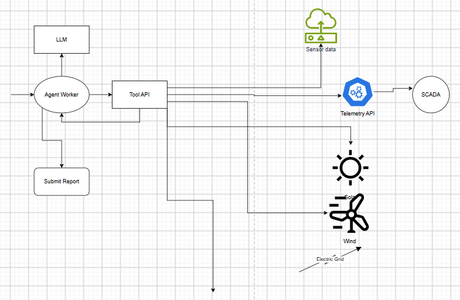

# AI Diagnostic Agents for Solar Power Plants
## Problem
Modern solar installations face numerous operational challenges that can significantly impact performance and profitability. Traditional diagnostic approaches often fail to identify problems until they've already caused substantial energy losses or equipment damage. An AI Agent can diagnose the issue of Solar Power Plant and share its diagnostic finding with a human Engineer for resolving the issue.

A leightweight prototype that checks timestamped plant readings for underperformance, then lets an LLM choose among read-only diagnostic tools. The demo uses synthetic plant data, not live plant data. The agent can be explained as shown below:


## Run

Install the local package into the project virtual environment, then run:

```powershell
.\.venv\Scripts\python.exe -m pip install -e .
$env:GEMINI_API_KEY = "your-api-key"
.\.venv\Scripts\python.exe main.py
```

Set `GEMINI_MODEL` to use a different supported Gemini model. The agent can
choose among three read-only tools: weather, panel condition, and inverter
comparison. It can make up to six tool calls per investigation. Missing source
data is reported as unavailable, and the model may skip checks based on prior
results. It returns `unknown` when evidence is insufficient, conflicting, or
uncited.

Run tests with:

```powershell
.\.venv\Scripts\python.exe -m unittest discover -s tests -v
```